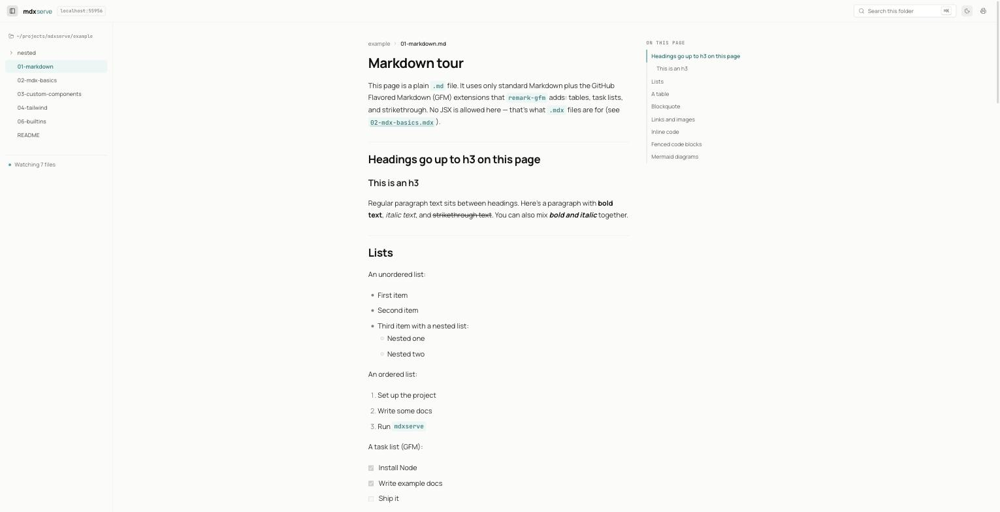
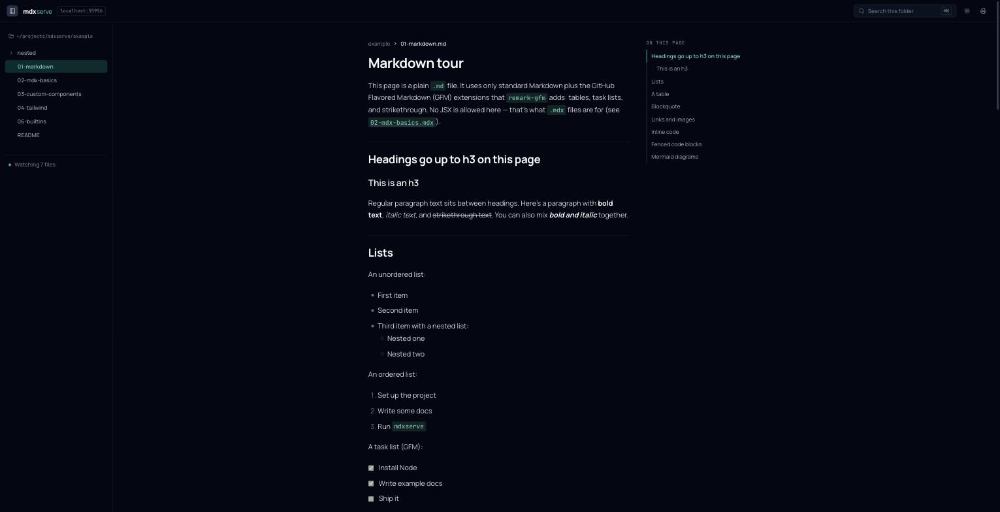
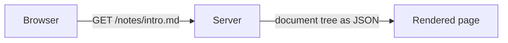
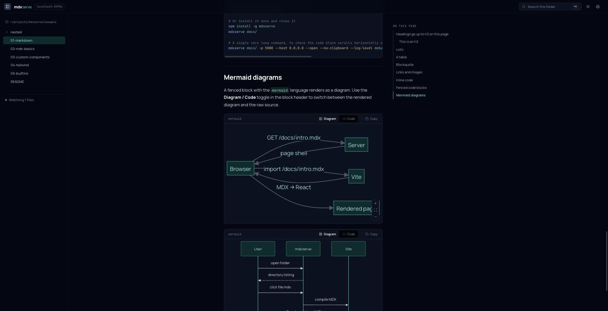
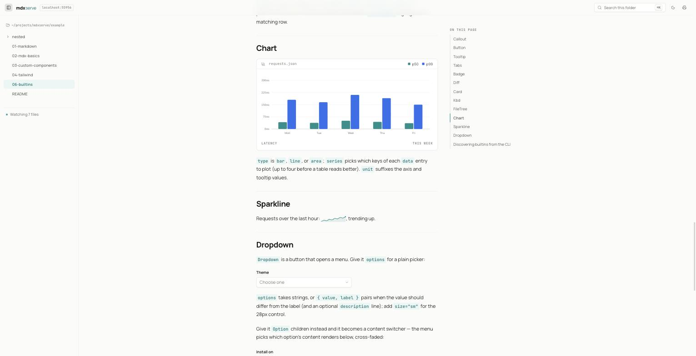

<p align="center">
    
</p>

<h1 align="center">mdxserve</h1>

<p align="center">The prettiest way to view Markdown and MDX.</p>

<p align="center">
    <a href="https://www.npmjs.com/package/@karimsa/mdxserve">
        
    </a>
    <a href="LICENSE">
        
    </a>
</p>

Point it at a folder of `.md` / `.mdx` files and it serves them as a site you can browse: a
listing of every folder, each file rendered as a page with syntax-highlighted code, mermaid
diagrams, and a set of builtin components, in light and dark. Save a file and the open page
updates. Files ending in `.mdx` render the same way as `.md`.





It works with folders of Markdown that already exist: notes, a `docs/` directory, or plan
files an AI agent wrote. For local use, there is no build step or config file: run it,
open the URL, and read. Use `--permissions restricted` to publish one folder as a read-only site.

## Install

You need Node 22.12 or newer.

```bash
npm install -g @karimsa/mdxserve
mdxserve setup      # optional: installs the agent skills for Claude Code and Codex
```

`mdxserve setup` copies the agent skills (writing docs, and running the server) into your Claude Code and Codex skill folders
(through `npx skills add`) and removes the MCP registration that older versions created. It is
safe to re-run; run it again after upgrading so the installed skill matches the CLI.

Interactive commands check for updates in the background at most once a day and show
cached update notices on startup. Updates are never installed automatically. Disable
checks with `--no-update-notifier` or `NO_UPDATE_NOTIFIER=1`. CI, noninteractive commands,
and `--json` output stay quiet.

## Quick start

```bash
mdxserve serve -w ~/notes          # serve one folder
mdxserve serve -w ~/notes -w ~/work/docs   # or several unrelated folders at once
```

Open the URL it prints (`http://127.0.0.1:4040` by default). With one folder you land in its
listing; with several, the home page lists them.

One server runs per user, and you can change what it serves without restarting it:

```bash
mdxserve roots add ~/work/docs     # start serving another folder
mdxserve roots remove ~/notes      # stop serving one
mdxserve roots list                # what is being served right now
mdxserve status                    # pid, port, URL, and the folders served
```

Roots persist in `~/.mdxserve/config.json` (`$MDXSERVE_HOME/config.json` when set).
`mdxserve serve` restores them on restart; `-w` adds folders to the saved list.
You can also edit the file directly, including while the server is stopped:

```json
{
	"roots": ["~/notes", "~/work/docs"]
}
```

The running server automatically reloads edits, updating open browsers and document access.
Relative paths resolve against the config directory; `~` resolves against your home directory.
Use `"roots": []` to unmount everything. Invalid JSON, missing directories, and invalid root
combinations leave the last working set active and log an error; fix the file to resume
reloading. Deleting the config while running also preserves the last working set until the
file is restored. An invalid config at startup reports an error. Root commands save changes
atomically and preserve unrelated settings. SQLite records only the live server's status;
the JSON file is the source of truth for which roots should exist.

| Flag                        | Default         | Effect                                                    |
| --------------------------- | --------------- | --------------------------------------------------------- |
| `-w, --watch`               | none            | Serve this folder; repeat the flag for more than one      |
| `-p, --port`                | `4040`          | Port to listen on; falls back to a free one if it's taken |
| `--host`                    | `127.0.0.1`     | Interface to bind; determines default permission mode     |
| `--dangerous-allow-network` | off             | Authorize full permissions on a non-loopback interface    |
| `--permissions <mode>`      | interface-based | `full` on loopback, `restricted` on other interfaces      |
| `--no-tailscale`            | off             | Skip looking for `tailscale serve`                        |

To open the server from your other devices, you do not need `--host` or
`--dangerous-allow-network`: keep it on loopback and publish it with `tailscale serve`. When
Tailscale is running, startup prints the exact command. Run it, restart the server, and the
tailnet address and live updates work through it. See
[Through `tailscale serve`](docs/advanced.md#through-tailscale-serve).

## Hosting a public reader

Permission mode defaults to `full` on loopback and `restricted` on other interfaces.
The effective mode is printed at startup. Use `--permissions restricted` to select the
public reader restrictions explicitly, including behind a proxy connected over loopback:

```bash
MDXSERVE_HOME=/tmp/mdxserve-public mdxserve serve --permissions restricted -w ./public --host 0.0.0.0 -p "${PORT:-4040}"
```

Restricted mode requires one `-w` directory. It ignores saved roots
and config changes. All HTTP mutations are denied, including editing, Trash, root changes,
and diagram agents, even when a reverse proxy connects over loopback. The reader,
navigation, and search remain available. A restricted instance will not reuse another server
under the same `MDXSERVE_HOME`; give it its own directory.

Treat every file in `./public` as public. Visitors can fetch document source and visible
files such as images. The server sends its own prebuilt client and nothing a document
author wrote runs in the browser. Hidden files, links to hidden targets, and links outside
the served root are blocked; links to visible files inside the root still work.
Run the server with a read-only site directory and no agent credentials. At the public proxy,
limit requests per client and concurrent requests to bound search work.
Full permissions on a non-loopback interface require both `--permissions full` and
`--dangerous-allow-network`. The dangerous flag alone leaves the default restricted mode
in place. Use full network access only on a trusted network.

## Writing docs

Any folder of Markdown works as-is. `.md` and `.mdx` are treated identically: both get
GitHub-flavored Markdown (tables, task lists, strikethrough), syntax-highlighted code blocks,
and mermaid diagrams. Both can also use the builtin components, a few lowercase HTML
elements, and literal values in braces (see [What a document can contain](#what-a-document-can-contain)).

Code fences take a title, a line-number gutter, and highlighted lines on the opening line:

````md
```ts title="src/server.ts" showLineNumbers {3-4}
const server = http.createServer(handler);
server.listen(port);
// these two lines are highlighted
console.log(`http://localhost:${port}`);
```
````

A ` ```mermaid ` fence renders as a pan-and-zoom diagram with a Diagram / Code toggle:

````md

````



### Page metadata

Add YAML frontmatter to set a page title, description, canonical URL, and Open Graph sharing tags. Metadata appears in the initial HTML response and updates as you navigate between documents. `.md` and `.mdx` use the same fields.

```yaml
---
title: My guide
description: How to get started.
canonical: https://docs.example.com/guide
openGraph:
  - property: og:title
    content: My guide
  - property: og:type
    content: article
  - property: og:url
    content: https://docs.example.com/guide
  - property: og:image
    content: https://docs.example.com/guide.png
  - property: og:image:alt
    content: A diagram from the guide
---
```

Use absolute public URLs for canonical links and sharing images. Open Graph values are explicit, so the sharing title can differ from the browser title. The list preserves repeated images and their attributes. See [metadata rules and validation](docs/advanced.md#page-metadata).

### Builtin components

A small set of components is available in every file, `.md` included, with no import:

| Component           | For                                                      |
| ------------------- | -------------------------------------------------------- |
| `Callout`           | A note, tip, or warning the reader must not miss         |
| `Tabs` / `Tab`      | Per-OS or per-language variants of the same instructions |
| `Badge`             | A status or tag inline with text                         |
| `Tooltip`           | A short explanation on hover                             |
| `Diff`              | A before/after code change, unified or side by side      |
| `Card` / `CardGrid` | Linked cards laid out in a grid                          |
| `Kbd`               | A keyboard shortcut                                      |
| `FileTree`          | The shape of a directory                                 |
| `Chart`             | A bar (vertical or horizontal), line, area, or histogram |
| `Sparkline`         | A tiny inline trend line                                 |
| `Screenshot`        | An app or UI screenshot framed as a macOS window         |

```mdx
<Callout tone="warn" title="Before you deploy">
	Rotate the key first; the old one stops working immediately.
</Callout>

<Tabs id="install-tabs">
	<Tab label="macOS">`brew install foo`</Tab>
	<Tab label="Linux">`apt install foo`</Tab>
</Tabs>

Status: <Badge tone="ok" dot>Online</Badge>
```



`Tabs`, `DataTable`, `Diff`, `FileTree`, `Chart`, `Screenshot` and the lowercase `details`
keep reader state (the selected tab, a table's sort, an open panel), so each one needs an `id`
that is unique in the document: a letter, then letters, digits, `-` and `_`. Keep the `id` when
you edit, and the reader keeps their state.

Every component's props are documented from the command line:

```bash
mdxserve components search           # list them all
mdxserve components show Callout     # props, defaults, and when to use it
```

### What a document can contain

A document is content, not code. mdxserve renders Markdown, the builtins above, and these
lowercase elements: `kbd`, `abbr`, `sub`, `sup`, `mark`, `b`, `i`, `u`, `s`, `em`, `strong`,
`small`, `br`, `span`, `details`, `summary`, `table` (with `thead`, `tbody`, `tr`, `th` and `td`
inside it), `a` and `img`.

- Braces hold a literal: an array, object, string, number, boolean or null. A prop receives it
  as is (`data={[{ label: "Mon", value: 3 }]}`). In prose, a string or number shows as its
  text, an array or object as its JSON, and `true`, `false` and `null` show nothing.
- There are no `import` or `export` statements and no custom components.
- `className`, `style` and event handlers (`onClick` and the rest) are not supported. The
  attributes a lowercase element keeps are `title` on `abbr`; `open` and `id` on `details`;
  `href` and `title` on `a`; `src`, `alt`, `title`, `width` and `height` on `img`; and
  `colspan`, `rowspan` and `align` on `th` and `td`.
- Links use http, https, mailto, a relative path or an `#anchor`.

A document that breaks a rule still renders what it can: an unknown tag shows its content, a
non-literal is left out, an unsupported attribute or a prop value of the wrong type is dropped,
and a stateful component with no `id` gets a generated one. A syntax error, such as a stray
`{`, only takes out its own `#`/`##` section, which is shown as source. `mdxserve validate`
reports each of these as an error with the change that fixes it.

### Heading ids

Every heading, tab and stateful component has an id in the document tree that
`mdxserve document <file>` prints. A heading whose text is unique in the document has its slug
as its id (`## Install it` is `install-it`), and that id is its URL anchor. When the same
heading text appears more than once, each of those headings is identified by its path from
the top heading instead, joined with `>` (`guide>install>examples`), and a tab by its `Tabs`
id and its value (`install-tabs>macos`). A tab has an anchor too: opening
`page.md#install-tabs>macos` selects that tab. A link to a short anchor such as `#examples`
still lands after a second "Examples" heading turned both ids into paths: a fragment that
matches no id goes to the first heading or tab whose id ends in `>examples`. The numbered
anchors earlier releases gave repeats, `#examples-1` and `#examples-2`, still reach the second
and third "Examples" heading.

### The example folder

[`example/`](./example) is a working tour of everything above — plain Markdown, the MDX
syntax a document can use, every builtin, and a page of charts. From a clone, after `yarn`:

```bash
yarn dev    # serves ./example
```

## Reading and editing

Every page has the same shell: a sidebar listing the folder you are in, the document, and a
table of contents that follows you as you scroll. The sidebar and the content column are
resizable. Pages link to their previous and next neighbour and show which file they came from
and when it was last edited.

- `⌘K` / `Ctrl K` searches every served folder by title, heading, and body. A result opens
  the page at the section or tab the match is in, selecting that tab.
- The top bar toggles light and dark (it remembers your choice) and prints.
- Double-click a section, or use its pencil, to edit it in place; `⌘S` saves,
  `Esc` cancels. The edit is written back to the file on disk. A builtin such as a `Callout`
  has a pencil of its own, and a diagram an Edit button. A paragraph holding an inline
  component, and a code fence with a title or highlighted lines, stay as raw source in the
  editor so a save cannot lose them. A save is refused only when it would add a validation
  error the file did not already have.
- Selecting an entry in the table of contents, a `#` link, a search result or a comment that
  points into an unselected tab selects that tab.
- Select text and press the comment button to start a thread on it. Agents reply by editing the
  file, since threads live in the doc's frontmatter. See
  [comments](docs/advanced.md#comments).
- Saving a file from your editor updates the open page in place, and a toast names what
  changed. Tab selections, table sorts and open `details` stay as they were.
- In a folder listing, select files to move them to the OS Trash (never deleted outright).
- Diagrams and charts open full-screen; a flowchart's direction can be flipped without
  touching the source.

Navigation is client-side — moving between folders and pages doesn't reload — and every
animation respects `prefers-reduced-motion`.

## Using it with AI agents

mdxserve is a good place to read what an agent writes — plan files, reports, design docs —
and it gives the agent tools to write for it well:

- **A writing skill.** `skills/mdxserve/SKILL.md` teaches an agent to write Markdown that
  renders richly here while staying plain and portable, and to check the builtin components
  before using them. `mdxserve setup` installs it for Claude Code and Codex.
- **A run skill.** `skills/mdxserve-run/SKILL.md` (`mdxserve:run`) tells an agent how to
  check for a running server, start it under `oxmgr`, manage roots, stop it, and reach it
  from another device with `tailscale serve`. `mdxserve setup` installs it too.
- **CLI verbs.** `mdxserve validate`, `document`, `search`, `docs`, `roots`, and `components`
  all take `--json`, so an agent can check a file, see the tree a reader gets, find docs, and
  manage served folders from a shell.

`validate` never needs a server and never renders the doc. It checks syntax, the document rules,
unknown components, prop names and values, and `id`s.
`mdxserve document <file> --json` prints the JSON document tree a client renders.
[`docs/advanced.md`](./docs/advanced.md#the-agent-cli) covers the verbs in detail.

## Keeping it running

`mdxserve serve` runs in the foreground. To keep it up after you close the terminal, use any
process manager — [oxmgr](https://github.com/Vladimir-Urik/OxMgr) is one option:

```bash
oxmgr start "mdxserve serve"
mdxserve roots add ~/notes

oxmgr logs mdxserve      # tail the server log
oxmgr stop mdxserve      # stop it
```

## Going further

| Read                                           | If you want to                                                                                           |
| ---------------------------------------------- | -------------------------------------------------------------------------------------------------------- |
| [`docs/advanced.md`](./docs/advanced.md)       | Understand the one-server-per-user model, URL and root rules, LAN exposure, the cache, and the agent CLI |
| [`docs/http-api.md`](./docs/http-api.md)       | Call the server's typed HTTP API directly                                                                |
| [`docs/development.md`](./docs/development.md) | Work on mdxserve itself: build, test, add a builtin, and where things live                               |
| [`AGENTS.md`](./AGENTS.md)                     | The architecture rules the codebase follows (also what coding agents read)                               |
