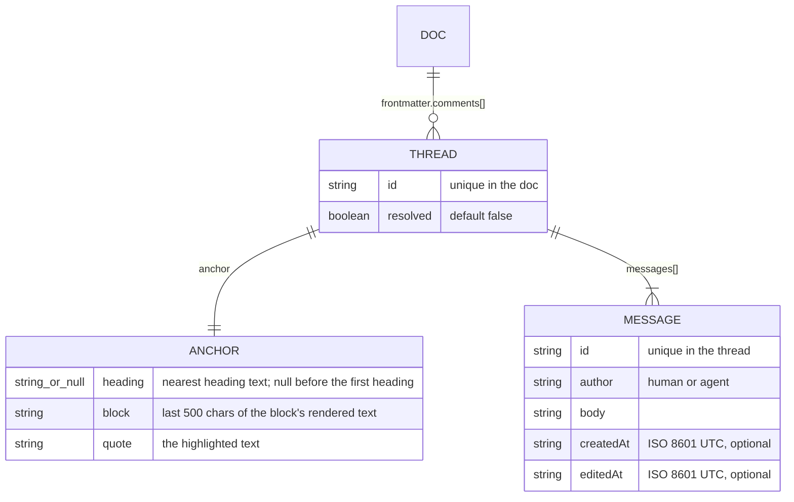
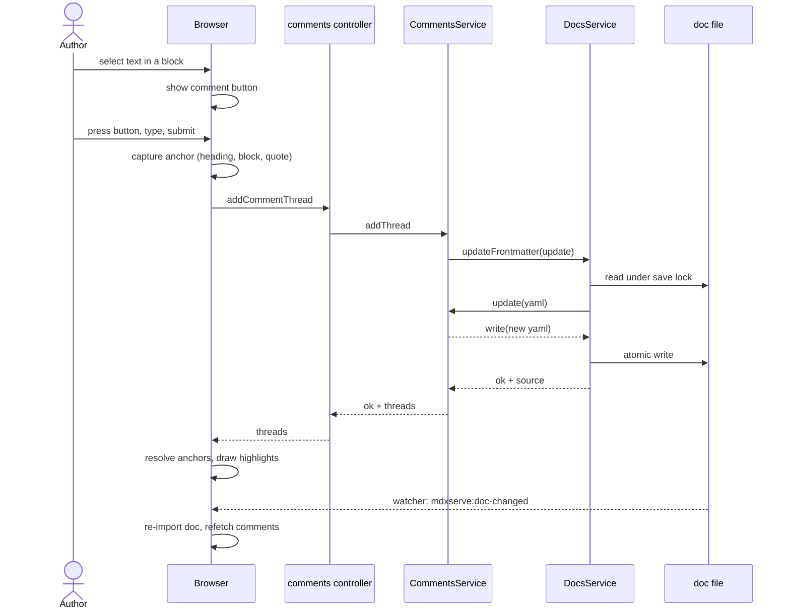
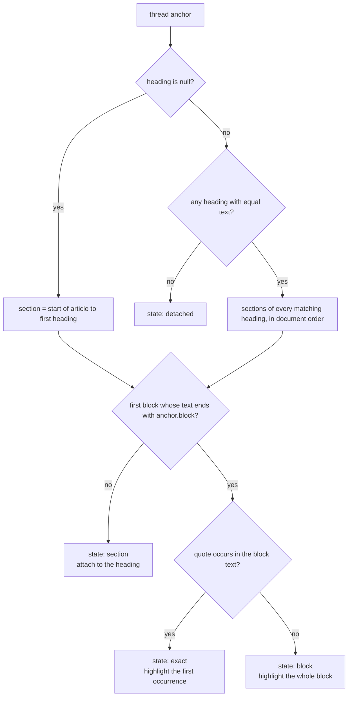

# Doc comments

Status: Draft for review. Source brainstorm: `docs/brainstorms/doccomments.md` (gitignored, main checkout).

Authors and agents leave threaded comments on a highlighted piece of a rendered doc. Threads are stored in the doc's own YAML frontmatter, so they travel with the file and an agent can read and answer them by editing the file.

## The Problem

mdxserve is where an author reads what an agent wrote, and where the author fixes small things in place. There is no way to say "this sentence is wrong" or "explain this" on the page. Today the author switches to a chat window, describes the location in words ("the second paragraph under Installation"), and the agent has to find it again. The feedback is lost once the chat ends, and nothing on the page shows that a passage is under discussion.

The same gap exists in the other direction. An agent that is unsure about a passage can only put a note in the body text, which changes the document it is asking about.

What the author needs:

- to point at exact words on the rendered page and attach a note to them;
- to have that note stay with the doc, where the agent already reads and writes;
- to have a conversation on that note (the agent answers, the author replies) and then close it;
- to see at a glance which passages have open notes.

## Requirements

Users: the **author** (a person using the browser on a full-permission server), the **agent** (a coding agent that reads and writes the doc file on disk), and the **visitor** (anyone reading on a restricted server).

Priority: P0 is required for the first release. P1 is wanted and may land after.

### Creating a comment

| ID  | Requirement                                                                                                                              | Priority |
| --- | ---------------------------------------------------------------------------------------------------------------------------------------- | -------- |
| C1  | The author shall be able to select text inside one block of a rendered doc and see a comment button next to the selection within 300 ms. | P0       |
| C2  | The author shall be able to press that button, type a comment, and submit it.                                                            | P0       |
| C3  | The author shall see the commented text highlighted in the doc after the comment is saved.                                               | P0       |
| C4  | The author shall see a selection that crosses blocks clipped to the block where the selection starts.                                    | P0       |
| C5  | The agent shall be able to create a comment by editing the doc file.                                                                     | P0       |

### Working with threads

| ID  | Requirement                                                                                              | Priority |
| --- | -------------------------------------------------------------------------------------------------------- | -------- |
| T1  | The author shall be able to reply to a thread; replies form one flat list under the first comment.       | P0       |
| T2  | The agent shall be able to reply to a thread by editing the doc file.                                    | P0       |
| T3  | The author shall be able to edit the text of a comment written by a human.                               | P0       |
| T4  | The author shall be able to resolve a thread; resolving applies to the whole thread.                     | P0       |
| T5  | The author shall be able to list resolved threads and reopen one.                                        | P0       |
| T6  | The author shall see each message labelled as written by a human or by an agent.                         | P0       |
| T7  | The author shall see an agent's reply in an open browser tab within 2 seconds of the file being written. | P0       |

### Viewing comments

| ID  | Requirement                                                                                                         | Priority |
| --- | ------------------------------------------------------------------------------------------------------------------- | -------- |
| V1  | The author shall see all threads of the open doc in a sidebar on the right of the page on screens 768 px and wider. | P0       |
| V2  | The author shall see the threads in a sheet that rises from the bottom of the screen on narrower screens.           | P0       |
| V3  | The author shall see, on each thread, a short quote of the text it is attached to.                                  | P0       |
| V4  | The visitor shall be able to read threads on a restricted server.                                                   | P0       |
| V5  | The visitor shall have no control that adds, edits, replies to, or resolves a comment on a restricted server.       | P0       |

### Anchoring

| ID  | Requirement                                                                                                    | Priority |
| --- | -------------------------------------------------------------------------------------------------------------- | -------- |
| A1  | The author shall see a thread on its original text after the doc is edited elsewhere.                          | P0       |
| A2  | The author shall see a thread attached to its section heading when its block can no longer be found.           | P0       |
| A3  | The author shall see a thread marked as detached when its section heading no longer exists.                    | P0       |
| A4  | The agent shall be able to list threads whose anchor no longer matches the doc by running `mdxserve validate`. | P1       |

### System requirements

| ID  | Requirement                                                                                                                            | Priority |
| --- | -------------------------------------------------------------------------------------------------------------------------------------- | -------- |
| S1  | The system shall store threads in the doc's leading YAML frontmatter under the key `comments`.                                         | P0       |
| S2  | The system shall behave the same for `.md` and `.mdx` files.                                                                           | P0       |
| S3  | The system shall accept a comment write from every caller that `saveDocSection` accepts, and from no other caller.                     | P0       |
| S4  | The system shall leave every body line of the doc byte-identical when it writes a comment.                                             | P0       |
| S5  | The system shall leave the parsed page metadata (`title`, `description`, `canonical`, `openGraph`) unchanged when it writes a comment. | P0       |
| S6  | The system shall refuse a comment write that would make the frontmatter larger than 64 KiB.                                            | P0       |
| S7  | The system shall refuse a comment write when the existing frontmatter is not valid YAML.                                               | P0       |
| S8  | The system shall report a malformed `comments` entry as a `mdxserve validate` warning.                                                 | P0       |
| S9  | The system shall keep comments out of HTML and PDF exports.                                                                            | P0       |
| S10 | The system shall not discard unsaved text in an open section editor because the author added a comment in the same tab.                | P0       |

### Descoped

- Storing comments in sqlite (brainstorm Path 2). Rejected: the agent could not reach them by editing the file, and a restricted server on another machine would have no copy.
- A line-number fallback for anchors (brainstorm Variant A). Rejected: every comment written to frontmatter shifts body lines, and a stale line number points at the wrong paragraph without any sign of failure.
- Named authors and per-author permissions. Authors are `human` or `agent` for now.
- Highlights that span more than one block.
- Notifying the agent that a comment is waiting. The author points the agent at the doc.
- Comments in exports.
- Deleting a thread or a message from the UI. Resolve hides a thread; the file can be edited by hand.
- CLI verbs for comments. The agent edits the file.

## Solution

### Data model

Threads live in the frontmatter of the doc they belong to. `parseMetadata` already skips unknown top-level keys, so the `comments` key does not affect page metadata.

```yaml
---
title: Getting started
comments:
  - id: k3J9xQ2a
    anchor:
      heading: Installation
      block: Run the installer, then restart your shell so the new PATH entry is picked up.
      quote: restart your shell
    resolved: false
    messages:
      - id: Zp41mD0c
        author: human
        body: Is a restart still needed on fish?
        createdAt: 2026-11-24T19:02:11.000Z
      - id: m2
        author: agent
        body: No. Fish reads conf.d on each prompt. I removed the restart step for fish.
        createdAt: 2026-11-24T19:05:40.000Z
---
```



Field rules, enforced by one zod schema in `src/comments/schema.ts`:

| Field                     | Rule                                                                                                                               |
| ------------------------- | ---------------------------------------------------------------------------------------------------------------------------------- |
| `thread.id`, `message.id` | `^[A-Za-z0-9_-]{1,64}$`. The server generates 8 base64url characters. An agent may write any value that matches, for example `m2`. |
| `anchor.heading`          | string of 1 to 300 characters, or `null`                                                                                           |
| `anchor.block`            | string of 1 to 500 characters                                                                                                      |
| `anchor.quote`            | string of 1 to 500 characters                                                                                                      |
| `resolved`                | boolean, defaults to `false` when absent                                                                                           |
| `messages`                | 1 to 100 entries                                                                                                                   |
| `message.author`          | `human` or `agent`                                                                                                                 |
| `message.body`            | string of 1 to 4000 characters                                                                                                     |
| `createdAt`, `editedAt`   | ISO 8601 date-time string, optional                                                                                                |

All three anchor strings hold **rendered text** in normalized form: runs of whitespace collapsed to one space, then trimmed. `block` is the last 500 characters of the block's normalized text, which is the whole text for most blocks.

A thread that fails the schema is skipped by the reader and reported as a warning. It is never removed from the file by the server. Unknown keys on a thread or message are kept on write and ignored on read.

#### Text model

- A **block** is the innermost element matching `p, li, td, th, h1, h2, h3, h4, h5, h6, pre, dt, dd, figcaption, summary` inside `article.mdx-prose`. Elements inside `[data-editing]`, `svg`, or `button` are not blocks.
- The **heading** of a block is the block itself when it is a heading, otherwise the nearest heading element (any level) before it in document order. A block before the first heading has heading `null`.
- A **section** is everything from a heading up to the next heading of any level. The `null` section runs from the start of the article to the first heading.

### Control flow

#### Modules

New domain module `src/comments/`:

| File             | Contents                                                                                             |
| ---------------- | ---------------------------------------------------------------------------------------------------- |
| `schema.ts`      | zod schemas, inferred types, and the limits above                                                    |
| `frontmatter.ts` | pure functions: `parseComments(source)` and `editComments(yaml, edit)`                               |
| `anchor.ts`      | pure functions: `normalizeText`, and a static resolver over an mdast tree used by validation         |
| `service.ts`     | `CommentsService`, constructed with a `DocsService`                                                  |
| `controller.ts`  | the tRPC procedures and their schemas; exports `commentsController`, spread into `src/api/router.ts` |

`CommentsService` holds no state. A procedure builds one per request with `new CommentsService(ctx.docs)`. The per-file save lock stays in `DocsService`.

Client code lives in `client/comments/`. It imports only types from `src/`, so the two limits it needs (500 for `block` and `quote`) and `normalizeText` are repeated there. A test imports both copies and asserts they agree.

#### Reading

`parseComments(source)`:

1. Call `leadingFrontmatter(source)`. No frontmatter means no threads.
2. Parse the YAML with `parseDocument(value, { uniqueKeys: true, lineCounter })`. On a YAML error return no threads and no diagnostics; `parseMetadata` already reports that error.
3. Read the `comments` key. Absent means no threads. Present and not a list is one diagnostic.
4. Validate each entry with the thread schema. Reject an entry that contains a YAML alias or a custom tag, as `parseMetadata` does. A failing entry adds one diagnostic with its line and is left out.
5. A duplicate `thread.id`, or a duplicate `message.id` inside one thread, is a diagnostic; the first one wins.

It returns `{ threads, diagnostics }`. Diagnostics have severity `warning` and the new code `frontmatter-comments`.

`CommentsService.list(path, publicOnly)` calls `docs.readSource(path, publicOnly)` and then `parseComments`. A doc over the 2 MiB source limit returns no threads.

#### Writing

A new method on `DocsService` does the file work, because it owns the save lock:

```ts
type FrontmatterUpdate<Abort> =
	| { kind: "write"; yaml: string }
	| { kind: "abort"; value: Abort };

type UpdateFrontmatterResult<Abort> =
	| { kind: "ok"; version: string; source: string }
	| { kind: "not-found"; message: string }
	| { kind: "aborted"; value: Abort }
	| { kind: "too-large" }
	| { kind: "busy" };

updateFrontmatter<Abort>(input: {
	path: string;
	update: (yaml: string | undefined) => FrontmatterUpdate<Abort>;
}): Promise<UpdateFrontmatterResult<Abort>>;
```

Inside `withSaveLock(realpath)`:

1. Read the file. Call `leadingFrontmatter`. Pass its `value` (or `undefined`) to `update`.
2. On `abort`, return `aborted`.
3. Build the new source. With existing frontmatter, replace the lines strictly between the two fences with the new YAML, keeping the file's EOL style. With none, insert `---`, the YAML, and `---` at the top of the file, after a BOM when there is one.
4. Return `too-large` when the YAML is over `MAX_YAML_BYTES` (64 KiB) or the file is over `MAX_SOURCE_BYTES`.
5. Check the boundary: `leadingFrontmatter(next)` must return the new YAML, and `bodyLines(next)` must equal `bodyLines(current)`. A failure throws; it is a bug, not a user error.
6. Write through the same temp-file, re-read, rename sequence `saveSection` uses. Move that sequence into one private method used by both.
7. When the re-read shows the file changed since step 1, start again from step 1. After three attempts return `busy`.

No doc `version` comes from the client. A comment write is a read-modify-write of the current file under the lock, so it does not conflict with a body edit made a moment earlier. The MDX validation step of `saveSection` is not run, since no body line changes.

`editComments(yaml, edit)` in `src/comments/frontmatter.ts` turns one YAML string into the next:

1. Parse with `parseDocument`. A YAML error, a root that is not a map, or a `comments` value that is not a list gives `invalid-frontmatter`.
2. Apply the edit on the YAML nodes (`Document.setIn`, `createNode`), finding a thread by `id` in the list. Other keys, other threads, invalid entries, and YAML comments are left as they are.
3. Serialize with `document.toString({ lineWidth: 0 })`.

`CommentsService` methods and result kinds:

| Method                                             | Result kinds besides `ok`                                                             |
| -------------------------------------------------- | ------------------------------------------------------------------------------------- |
| `addThread({ path, anchor, body })`                | `not-found`, `invalid-frontmatter`, `too-large`, `busy`                               |
| `addReply({ path, threadId, body })`               | the above, plus `thread-not-found`                                                    |
| `editMessage({ path, threadId, messageId, body })` | the above, plus `message-not-found`, `not-editable` (the message's author is `agent`) |
| `setResolved({ path, threadId, resolved })`        | `not-found`, `thread-not-found`, `invalid-frontmatter`, `too-large`, `busy`           |

Every `ok` result carries the full thread list parsed from the source that was written. A message written through the service always has `author: "human"`, a generated id, and `createdAt` set to now. `editMessage` sets `editedAt`.

#### HTTP API

| Method                     | Kind     | Input                                 | Output                     |
| -------------------------- | -------- | ------------------------------------- | -------------------------- |
| `getDocComments`           | query    | `{ path }`                            | `{ threads, diagnostics }` |
| `addCommentThread`         | mutation | `{ path, anchor, body }`              | `{ threads }`              |
| `addCommentReply`          | mutation | `{ path, threadId, body }`            | `{ threads }`              |
| `editComment`              | mutation | `{ path, threadId, messageId, body }` | `{ threads }`              |
| `setCommentThreadResolved` | mutation | `{ path, threadId, resolved }`        | `{ threads }`              |

All are built with `procedure("<description>")` and nothing else. The existing middleware then gives the required permissions: mutations fail with `FORBIDDEN` on a restricted server and for cross-origin callers, and are open to the same callers as `saveDocSection`. `getDocComments` passes `ctx.permissions === "restricted"` as `publicOnly`, as `getDocSource` does.

Result kind to `TRPCError` code:

| Kind                                                 | Code                    |
| ---------------------------------------------------- | ----------------------- |
| `not-found`, `thread-not-found`, `message-not-found` | `NOT_FOUND`             |
| `not-editable`                                       | `FORBIDDEN`             |
| `invalid-frontmatter`                                | `UNPROCESSABLE_CONTENT` |
| `too-large`                                          | `PAYLOAD_TOO_LARGE`     |
| `busy`                                               | `CONFLICT`              |

#### Adding a comment



#### Capturing an anchor (browser)

1. Take the selection's range. Stop when it is collapsed, outside `article.mdx-prose`, or inside `[data-editing]`.
2. Find the block that contains the range start. Stop when there is none.
3. Clip the range end to that block.
4. `quote` is the normalized text of the clipped range, cut to 500 characters. Stop when it is empty.
5. `block` is the last 500 characters of the block's normalized text.
6. `heading` is the normalized text of the block's heading, or `null`.

#### Resolving an anchor (browser)



A thread in state `section` with a `null` heading attaches to the top of the doc and has no highlight.

Resolution runs for every unresolved thread after each of: the thread list changes, `DocView` reports a render (`onRendered`), a section editor closes. It reads the DOM and never changes it.

The mapping from a normalized-text offset back to a DOM `Range` is a pure function over the list of the block's text-node strings. It lives in `client/comments/anchor.ts` and is tested without a DOM.

#### Highlights

Highlights use the CSS Custom Highlight API: resolved ranges go into `CSS.highlights` under `mdxserve-comment`, and the focused thread's range under `mdxserve-comment-active`. `app.css` styles them with `::highlight()` and the existing design tokens. React's DOM is not touched, so a doc re-render cannot clash with the marks.

A click inside the article is hit-tested against the ranges (`caretPositionFromPoint`, with `caretRangeFromPoint` as fallback). A hit opens the panel and focuses that thread. In a browser without `CSS.highlights`, no highlight is drawn and the panel still works.

#### Panel

The visual spec is `docs/design/doc-comments/mockup.html` (open it in a browser). One thread layout, the **timeline**, is used in three containers.

Timeline (one thread):

- Top row: the quote on one line, drawn with the highlight colour, and a checkmark icon button that resolves the thread. On the Resolved tab the button is a Reopen icon.
- Messages in order. Each has a 24 px round avatar (a person icon for `human`, a spark icon on the accent-soft surface for `agent`), the name ("You" or "Agent"), a relative time, and the body. A 1 px line joins the avatars of consecutive messages.
- A human message shows an Edit action on hover or focus; editing swaps the body for the reply field.
- The reply row, on the active thread only: an avatar and a one-line field that grows with its content up to 120 px, with a round send button that turns accent-coloured when there is text. Enter sends, Shift+Enter adds a line.
- A thread in state `section` shows "Original text not found. Showing on the section." A detached thread shows "Original section not found."

Containers:

- **Sidebar** (768 px and wider): a 348 px column, full height under the top bar, flush to the right edge of the window, on the page surface with a left border. It is a sibling of `<main>`, not a floating box inside it. The header holds only the Open and Resolved tabs with counts (underline style) and a close button; there is no title. Threads are separated by hairlines, not cards. The active thread sits on the card surface. The table-of-contents rail is hidden while the sidebar is open. The open state is stored in `localStorage` (`mdxserve.comments.open`).
- **Popover** (768 px and wider, sidebar closed): a 360 px card under the highlight with the same timeline and three icon buttons: resolve, open in sidebar, close. It is placed with `@floating-ui/dom` against the highlight's range and follows scroll. Escape or a click outside closes it.
- **Sheet** (below 768 px): fixed to the bottom, at most 70% of the viewport height, with the same header and threads as the sidebar.

Behaviour:

- Sidebar closed: clicking a highlight opens the popover for that thread.
- Sidebar open: clicking a highlight makes that thread active in the sidebar and scrolls it into view. No popover.
- "Open in sidebar" on the popover opens the sidebar with that thread active and closes the popover.
- With the sidebar closed, **gutter counters** show at the right edge of the doc column, level with each open thread's anchor: a small pill with the message count. Clicking one opens the popover. They are hidden while the sidebar is open and below 768 px.
- A new comment (from the selection button) opens the popover with an empty thread and the field focused, whether or not the sidebar is open. Below 768 px it opens the sheet with the composer.
- An unsent reply is kept per thread while the doc stays open.
- Below 768 px, tapping a highlight raises the sheet scrolled to that thread.
- `TopBar` has a comments button on doc routes showing the number of open threads. On a restricted server it is shown only when the doc has at least one thread.
- Open threads are ordered by the document position of their resolved anchor. Detached threads come last under a "Detached" label.
- On a restricted server no reply row, checkmark, Reopen, or Edit action is shown.
- Highlights keep the marker style (amber fill, darker when active).

#### Selection button

`SelectionButton` listens to `selectionchange` and `pointerup`. It shows when the capture steps above succeed, the server is not restricted, and no section editor is open (`openSectionAtom` is `null`). It is placed with `computePosition` from `@floating-ui/dom` against the selection's rectangle: above the selection with a pointer, below it on touch, where the system selection menu sits above. It handles `pointerdown` with `preventDefault` so the selection survives the press. Pressing it stores the captured anchor as a draft and opens the popover (the sheet below 768 px) with the composer focused. Escape discards the draft.

#### Keeping the tab in sync

- The browser reads threads with `useQuery(trpc.getDocComments.queryOptions({ path }))`.
- A mutation's response replaces the cached thread list at once.
- The existing `mdxserve:doc-changed` handler in `client/router.ts` also invalidates the comments query for that path. This is how an agent's reply appears.
- Before each mutation the client records the path in a short-lived set (2 seconds). The "Reloaded" toast handler in `client/ui/Toast.tsx` skips a path found there, so the author's own comment does not produce a reload toast.

#### Not disturbing a section editor

A comment write changes the frontmatter's line count, so every section's `startLine` and `endLine` shift, and `MdSection` remounts any open editor. To meet S10, all comment controls that write (selection button, reply box, Edit, Resolve, Reopen) are disabled while `openSectionAtom` is not `null`. A write from another tab or from the agent behaves as any outside file change does today.

#### Validation and the agent

- `validateText` appends `parseComments(source).diagnostics`.
- For A4, `src/comments/anchor.ts` resolves each open thread against the captured mdast tree: headings and blocks come from `heading`, `paragraph`, `tableCell`, and `code` nodes, with text from `mdast-util-to-string` and the same normalization. It reports a `comment-anchor` warning for a missing heading and for a missing block. This is an approximation of the rendered text. Text that a component produces from props is not visible to it.
- `DiagnosticCode` gains `frontmatter-comments` and `comment-anchor`.
- `skills/mdxserve/SKILL.md` gets a "Comments" section: where threads are, the schema, how to reply (append a message with `author: agent`), how to write `anchor` values (plain rendered text, no Markdown markup), how to repair an anchor after moving text, never to remove a human's message, and to run `mdxserve validate` afterwards.

#### Exports and search

- The standalone bundle does not mount `AppShell` and has no tRPC client, so no comment UI or data reaches an export. The YAML node does not render.
- `DocCache` reads the first 64 KiB of a file, frontmatter included. Raise its read window by `MAX_METADATA_PREFIX_BYTES` so a doc with full frontmatter still has 64 KiB of body indexed.

### Considerations

- **Comments are public where the doc is.** A restricted server shows threads, `getDocSource` returns them, and they are committed with the file. This is accepted (V4). An author who wants private notes has no place for them.
- **One YAML error hides everything.** A hand edit that breaks the YAML empties the page metadata and all threads until fixed. The server refuses to write over it (S7) and `mdxserve validate` reports it. Server writes always go through the YAML library.
- **Storage is small.** One thread costs about 0.7 to 1.5 KiB. The 64 KiB limit, shared with page metadata, holds roughly 50 to 80 threads, resolved ones included. Past that, writes fail with `too-large` and the author removes resolved threads from the file by hand.
- **A long suffix is strict.** For a block under 500 characters, `block` is the whole text, so any edit to the paragraph drops the thread to its section heading. This is the chosen trade: loose placement, repaired by an agent.
- **First occurrence wins.** A quote that appears twice in a block highlights the first one, also when the author selected the second.
- **Heading renames detach.** Renaming a heading detaches every thread under it. Two headings with the same text are searched in document order, so a thread can attach under the wrong one when their blocks are identical.
- **Every comment is a file write.** It triggers the watcher, a doc re-import, and a new file version. A section editor open in another tab gets a conflict on save or loses its text, as with any outside edit.
- **Formatting of hand-written YAML can change.** The first server write re-serializes the frontmatter. Keys, values, and YAML comments are kept; quoting and indentation can be normalized.
- **Author is self-declared.** A file edit can claim either author. A LAN caller on a network-enabled server writes as `human`.
- **Static anchor warnings can be wrong** for text rendered by a component, in both directions. They are warnings and never fail validation.
- **Highlight support.** The CSS Custom Highlight API is missing in older browsers; those show the panel without marks.

Decisions made while writing this design that were not settled in the brainstorm:

1. Threads are a flat list in the panel in document order, not placed beside their anchor.
2. The comments rail replaces the table-of-contents rail while open.
3. Only human messages can be edited through the API.
4. There is no delete in the UI.
5. Comment writes are disabled while a section editor is open in the same tab.
6. The frontmatter limit stays at 64 KiB and writes past it are refused.
7. `mdxserve validate` reports schema problems (P0) and anchor drift (P1).
8. Comments are left out of exports.

## Productionizing

mdxserve is a local tool with no telemetry, so correctness is shown by tests and by `mdxserve validate`.

Tests, following the repo layout:

| File                                            | Covers                                                                                                                                                           |
| ----------------------------------------------- | ---------------------------------------------------------------------------------------------------------------------------------------------------------------- |
| `tests/comments/frontmatter.test.ts`            | parse and edit cases: no frontmatter, empty block, BOM, CRLF, invalid entries kept, duplicate ids, alias rejection                                               |
| `tests/comments/frontmatter.property.test.ts`   | any body string (including lines of `---`, unicode, newlines) survives write then parse; other keys parse to the same values before and after any edit           |
| `tests/comments/service.test.ts`                | each method and each result kind                                                                                                                                 |
| `tests/comments/service.property.test.ts`       | for any sequence of mutations: body lines byte-identical (S4), `parseMetadata` unchanged (S5), frontmatter never over 64 KiB (S6), no write on a non-`ok` result |
| `tests/comments/controller.test.ts`             | kind to `TRPCError` mapping; `FORBIDDEN` for restricted and cross-origin mutations; restricted `getDocComments` works                                            |
| `tests/comments/controller.property.test.ts`    | inputs outside the schema limits are rejected before the service runs                                                                                            |
| `tests/comments/anchor.test.ts`                 | static resolver states and warnings                                                                                                                              |
| `tests/docs/service.test.ts` (extended)         | `updateFrontmatter`: insert, replace, retry on outside write, `busy`, symlink target, file mode kept                                                             |
| `tests/client/comments-anchor.test.ts`          | capture and resolve on fixed inputs; the four states; clipping; first occurrence                                                                                 |
| `tests/client/comments-anchor.property.test.ts` | capture then resolve on an unchanged doc gives `exact` and the same quote; offset mapping round-trips                                                            |
| `tests/client/comments-limits.test.ts`          | client and server limits and `normalizeText` agree                                                                                                               |
| `tests/validation/` (extended)                  | `frontmatter-comments` and `comment-anchor` warnings never change `ok`                                                                                           |

Browser check before the PR, with screenshots uploaded to the PR description: create a thread from a selection, reply, edit, resolve, reopen; an agent-style file edit appears without reload; the phone-width sheet; a restricted server shows threads with no write controls; an export contains no comments.

Signals that the design is failing in use:

- `frontmatter-comments` or `comment-anchor` warnings on docs the server itself wrote.
- `too-large` errors in normal use, which would mean the 64 KiB limit is too low.
- Threads in state `section` after edits that did not touch their paragraph.

There are no alerts; this runs on the author's machine.

## Tasks

- [x] `src/comments/schema.ts`: schemas, types, limits
- [x] `src/comments/frontmatter.ts`: `parseComments`, `editComments`, with tests and property tests
- [x] `DocsService.updateFrontmatter`, sharing the atomic write with `saveSection`, with tests
- [x] `src/comments/service.ts` with tests and property tests
- [x] `src/comments/controller.ts`, added to `src/api/router.ts`, with tests
- [x] `validateText`: `frontmatter-comments` diagnostics
- [x] `client/comments/anchor.ts`: normalize, capture, resolve, offset mapping, with tests
- [x] `client/comments/`: DOM block collection and highlight registry; `::highlight()` styles in `app.css`
- [x] `SelectionButton`
- [x] `CommentsPanel`, `ThreadCard`, `CommentsRail`, `CommentsSheet`; `TopBar` button; `AppShell` wiring
- [x] Query invalidation on `mdxserve:doc-changed`; reload-toast suppression for own writes
- [x] Disable comment writes while a section editor is open
- [x] Restricted-mode read-only panel
- [x] `DocCache` read window
- [x] P1: static anchor resolver and `comment-anchor` warnings
- [x] Docs: `skills/mdxserve/SKILL.md`, `docs/advanced.md`, `docs/http-api.md`, `README.md`
- [x] Panel redesign: timeline thread, docked sidebar, popover, gutter counters, sheet
- [ ] Browser verification and screenshots

## Changelog of design

- 2026-11-24: Brainstorm settled the requirements: highlight to comment, edit, resolve, flat threads, human/agent authors, edit-permission parity, read-only on restricted servers, right sidebar, bottom sheet on phones, quoted highlight per thread.
- 2026-11-24: Anchor chosen as (nearest heading, 500-character block suffix, quote) on rendered text, first occurrence, clipped to one block, `null` heading before the first heading, fallback to the section heading. Line-number fallback dropped.
- 2026-11-24: Storage chosen: YAML frontmatter. sqlite rejected.
- 2026-11-24: Design written. Eight decisions not covered by the brainstorm are listed under Considerations for review.

- 2026-11-24: Panel redesigned after review of the first build. Chosen from five mockups: the conversation timeline as the single thread layout, in a docked full-height sidebar, a popover on the highlight when the sidebar is closed, and the phone sheet. Resolve is a checkmark, the reply is a one-line growing field, the panel has no title, gutter counters mark threads when the sidebar is closed. Highlight style stays marker.

## Changelog of implementation

- 2026-11-24: Implementation started on the `comments` branch. Backend (`src/comments/`, `DocsService.updateFrontmatter`, validation, `DocCache`) and the docs are in progress; the client follows once the API types exist.
- 2026-11-24: Backend and docs done and reviewed; typecheck, lint and 1061 tests pass. Deviations: `DocCache` reads a wider window but still indexes exactly 64 KiB of body after the frontmatter; message bodies with trailing whitespace or carriage returns are written as double-quoted YAML scalars; `comments: null` is read as an empty list; the service normalizes anchor text itself. Client in progress.
- 2026-11-24: Client done (`client/comments/`, `AppShell`, `TopBar`, toast suppression, query invalidation); typecheck and lint clean, 1096 tests pass. Deviations: the heading "#" link (`.mdx-anchor`) is excluded from block text; headings are compared on their first 300 characters; anchor resolution is paused while a section editor is open; the phone sheet's open state is not persisted; a detached card shows "Original section not found." API checked end to end with curl against a dev server (add, reply, edit, resolve, reopen, 404 on unknown thread, 403 cross-origin). Browser verification still outstanding: the Chrome extension was not connected.
- 2026-11-24: Panel redesign built: timeline `Thread`, `ReplyField`, `CommentsSidebar` (sibling of `<main>`), `CommentsPopover`, `GutterCounters`, reworked sheet; `MessageBox`, `ThreadCard` and `CommentsRail` removed. Deviations: the sheet has no scrim so highlights stay tappable; an outside click does not close a popover holding unsent new-comment text; gutter counters sit just right of the doc column. Message times use the compact form ("12m", "3h", "2d", then a short date). Fixed a racy test for `updateFrontmatter` and `saveSection` sharing the lock. Typecheck and lint clean, 1103 tests pass. Browser verification still outstanding.
- 2026-11-24: Committed the feature (`3e1d908`). Agent guidance in `skills/mdxserve/SKILL.md` rewritten around the user-driven workflow: the person comments in mdxserve, then asks the agent to look; the agent reads the frontmatter, acts, replies in the thread, and leaves resolving to the person. Agents start threads only when asked to review. `mdxserve validate` confirmed to check comments with and without a server; its warnings now quote the thread id and list every problem of a malformed entry.
