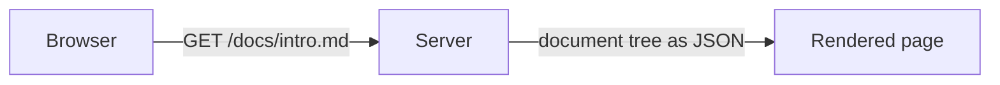
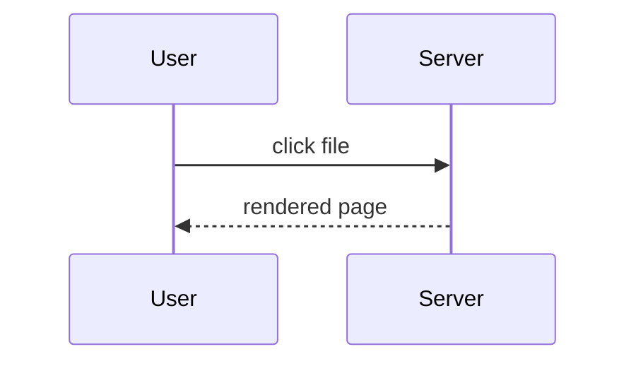

# Writing Markdown for mdxserve

mdxserve serves a folder of `.md` / `.mdx` files as a browsable site: a file listing,
rendered pages with syntax highlighting, mermaid diagrams, and a small library of builtin
components. `.md` and `.mdx` are treated identically, so the builtin
components work in either.

Markdown files have many readers besides mdxserve (GitHub, editors, other tools). The goal
is the **simplest Markdown that is still visual**: reach for richer features only when they
add clarity, and prefer features that degrade gracefully everywhere else.

## The ladder — prefer lower rungs

1. **Plain GitHub-flavored Markdown.** Headings, short paragraphs, lists, task lists, tables,
   links, bold for the one thing that matters. Works everywhere. Most content should stop here.
2. **Fenced code with a language tag.** Always tag the language (`ts`, `bash`, `json`, …). Add
   fence meta when it helps the reader: `title="path/to/file.ts"`, `showLineNumbers`,
   `{3-5}` to highlight lines. mdxserve renders these richly; other tools ignore the meta.
3. **Mermaid diagrams** for flows, sequences, states, and architecture. mdxserve renders them as
   pan/zoomable diagrams (with a toggle to the source); GitHub renders them too; everywhere else
   they are still readable text. Prefer `flowchart` and `sequenceDiagram`; keep a diagram to
   roughly 15 nodes or fewer — split larger ones. Never use mermaid's `pie`, `xychart-beta`,
   `quadrantChart`, or `sankey-beta` — mdxserve doesn't render them, `mdxserve validate` reports an
   error on them, and they draw data, which is `<Chart>`'s job (or a table). Mermaid is for a
   flow or a shape, not a dataset.
4. **Builtin components** (`<Callout>`, `<Tabs>`, `<Badge>`, `<Tooltip>`, `<Diff>`, `<Card>`,
   `<Kbd>`, `<FileTree>`, `<DataTable>`, `<Chart>` (bar, line, area, histogram), `<Sparkline>`, `<Screenshot>`) only when they make
   the content clearer: a warning the reader must not miss, per-OS or per-language variants of the
   same instructions, a status label, a small dataset that's clearer as a shape than a table.
   Outside mdxserve these show as raw tags, so use them sparingly and never for decoration.

Don't: write raw HTML or inline styles; import or create custom components; use emoji as
icons where a `Badge` or `Callout` would do; nest components for layout; put a component in a
file the user will mainly read elsewhere (e.g. a README on GitHub) unless they asked.

A document is content, not code. mdxserve does not run anything a document writes:

- No `import` or `export`, and no component that is not a builtin.
- Braces hold literals only: an array, object, string, number, boolean or null, as in
  `data={[{ label: "Mon", value: 3 }]}`. Write a dataset inline in each component that uses it;
  there is no way to declare it once. No `{1 + 1}`, no variables, no functions.
- No `className`, `style` or event handlers (`onClick` and the rest).
- The lowercase elements that work are `kbd`, `abbr`, `sub`, `sup`, `mark`, `b`, `i`, `u`, `s`,
  `em`, `strong`, `small`, `br`, `span`, `details`, `summary`, `table` (with `thead`, `tbody`,
  `tr`, `th` and `td` inside it), `a` and `img`. Prefer Markdown syntax over any of them.
- Links use http, https, mailto, a relative path or an `#anchor`.

`mdxserve validate` reports each break as an error, and the page renders without it.

MDX is stricter than Markdown: a bare `{`, `}` or an unclosed `<tag>` in prose is a syntax
error, not literal text. The error replaces only its own `#` or `##` section, which the reader
shows as source with the error. Put such characters in backticks or escape them (`\{`).

## Quick reference

A table beats a list of "X: Y" lines:

```md
| Option   | Default | Effect                    |
| -------- | ------- | ------------------------- |
| `--port` | `4040`  | Port to listen on         |
| `--host` | `127.0.0.1` | Interface to bind (`0.0.0.0` for LAN) |
```

Code with a title, line numbers, and highlighted lines:

````md
```ts title="src/server.ts" showLineNumbers {3-4}
const server = http.createServer(handler);
server.listen(port);
// highlighted:
console.log(`http://localhost:${port}`);
```
````

A flow and a sequence:

````md

````

````md

````

Task lists for progress; keep them flat:

```md
- [x] Read the existing router
- [ ] Add the listing endpoint
- [ ] Verify in the browser
```

## Builtin components

Available in any `.md` or `.mdx` with no import. The registry — not this file — is the
authoritative list of components and props. Before using a component for the first time in a
session, check it:

```bash
mdxserve components search           # list every builtin with a one-line description
mdxserve components search tab       # search by name, description, or prop name
mdxserve components show Callout     # props table (types, defaults) + when to use
mdxserve components show Callout --json
```

If `mdxserve` is not on your PATH, install it with `npm install -g @karimsa/mdxserve`.

Minimal usage:

```mdx
<Callout tone="warn" title="Before you deploy">
  Rotate the key first; the old one stops working immediately.
</Callout>

<Tabs id="install-tabs">
  <Tab label="macOS">`brew install foo`</Tab>
  <Tab label="Linux">`apt install foo`</Tab>
</Tabs>

Status: <Badge tone="ok" dot>Online</Badge>

The <Tooltip content="Mean time to recovery">MTTR</Tooltip> improved.

<Diff id="port-diff" before={`port: 3000`} after={`port: 4000`} />

Press <Kbd>⌘</Kbd><Kbd>K</Kbd> to open search.
```

Components contain ordinary Markdown: a `Tab` can hold lists, paragraphs, and code fences.
Leave a blank line between a component tag and a Markdown block inside it so the block is
parsed as Markdown.

`Tabs`, `DataTable`, `Diff`, `FileTree`, `Chart`, `Screenshot` and `<details>` keep reader
state, so each needs an `id`: short, descriptive, unique in the document, starting with a
letter and using only letters, digits, `-` and `_` (`id="install-tabs"`). It must not equal a
heading's anchor (the heading's slug, so not `id="install"` next to `## Install`). Keep the
`id` when you edit the block. Give sibling headings distinct text: two `## Steps` under the
same parent are an error. Ids are also URL anchors: link to a heading as `#install` and to a
tab as `#install-tabs>macos`, which opens that tab. `mdxserve document <file>` prints the table
of contents with the id of every entry.

## Tables: data versus facts

Use **`DataTable` for datasets**: measurements, metrics, budgets, benchmarks, and records
readers will compare, sort, or filter. Use **native Markdown tables for facts**: option
references, prose comparisons, and key/value documentation. Native tables get the same
bordered interface with conservative type detection; they do not automatically get bars.
Native tables use heading context for generated IDs. Same-header tables within the same
heading context remain interactive but do not persist preferences; use explicit `DataTable`
IDs when persistent state is required for those tables.
Both forms work identically in `.md` and `.mdx`. For documents mainly read elsewhere,
retain portable Markdown unless richer mdxserve content was requested.

Check `mdxserve components show DataTable` before first use. Supply a stable, descriptive
`id` unique within the document, and preserve it when updating data. Sorting, filters, and
unit preferences are saved locally under the document and ID. Give columns stable unique
`key` values; row objects use those keys. Missing values use `null`, never an invented zero.

```mdx
<DataTable
  id="endpoint-performance"
  caption="Endpoint performance"
  columns={[
    { key: "endpoint", label: "Endpoint", type: "text" },
    { key: "success", label: "Success", type: "percent" },
    { key: "mean", label: "Mean", type: "time", unit: "ms", group: "Latency", bars: true },
    { key: "peak", label: "Peak", type: "time", unit: "ms", group: "Latency", bars: true },
    { key: "payload", label: "Payload", type: "bytes", unit: "B" },
    { key: "cost", label: "Cost", type: "currency", currency: "USD" }
  ]}
  data={[
    { endpoint: "/search", success: 0.995, mean: 120, peak: 450, payload: 2048, cost: 1234.5 },
    { endpoint: "/export", success: 0.98, mean: 2400, peak: 8000, payload: 1048576, cost: 96.75 }
  ]}
/>
```

- `text` uses strings; readers filter with a regular expression, case-insensitive.
- `number` uses finite numbers; readers filter by inclusive minimum and maximum.
- `percent` uses **fractions**: `0.15` displays **15%**. Filter inputs use displayed percentage
  points (`15` or `15%`), not fractions.
- `time` uses numeric data and a required base `unit` accepted by `ms` (e.g. `ms`, `seconds`,
  `hours`). One unit is chosen for the entire column; readers can override it. Filters accept
  durations such as `500ms` or `2s`; bare numbers use the currently displayed unit.
- `bytes` uses numeric data and a required base `unit` accepted by `bytes` (`B`, `KB`, `MB`,
  `GB`, `TB`, `PB`). Units are binary (1 KB = 1024 B). The whole column shares a display unit;
  filters accept `10MB`, or bare numbers in the displayed unit.
- `currency` uses numeric data and a required ISO 4217 `currency` code in uppercase
  (`{ key: "cost", label: "Cost", type: "currency", currency: "USD" }`). Values display as
  money (`$1,234.50`) and sort numerically. Filters accept plain numbers or `k`/`m`/`b`/`t`
  suffixes (`10k`). A missing or malformed code is a validation error.
- Adjacent columns with the same `group` get a shared top-level heading.
- Optional `align: "left" | "center" | "right"` overrides type-based alignment. Native Markdown tables preserve explicit GFM delimiter alignment.
- Set `bars: true` only when comparing magnitudes is meaningful. Omit it for IDs, years,
  ranks, or ambiguous measurements. Each column has its own zero-inclusive scale, fixed
  across sorting/filtering; negative values extend left of zero. Equal bar lengths across
  different columns do not imply equal quantities.

## Plan files

Plans are read in mdxserve and in plain text. Use headings for phases, a task list per phase,
a table for files-to-change, and at most one mermaid diagram (the architecture or the main
flow, never a chart). Skip components in plans unless the user views plans only in mdxserve.

## Comments

Comments belong to the reader. A person opens the doc in mdxserve, highlights text, and leaves
a threaded comment on it; then they ask you to deal with the comments. Threads are stored in
the doc's own leading YAML frontmatter under `comments`, not in the body.

### When the user asks you to look at the comments

"Look at my comments", "address the feedback on the doc", "I left notes in mdxserve" all mean
this:

1. **Read the whole file, frontmatter included.** The threads are in the `comments` list at
   the top. They are not in the rendered page text, and a search of the body will not find
   them.
2. **Take the open threads**: entries with `resolved: false` or no `resolved` key. Skip
   resolved ones.
3. **Find what each one is about.** `anchor.heading` is the section, `anchor.block` is the
   paragraph or list item, `anchor.quote` is the exact words the person highlighted. The last
   `human` message in `messages` is what to act on.
4. **Do what it asks.** Edit the body for a change request. For a question, answer it in the
   thread and leave the body alone unless the answer belongs in the doc.
5. **Reply in the thread** with one short message saying what you changed or the answer.
   Append it to that thread's `messages` with `author: agent`.
6. **Repair the anchor** if your edit changed or moved the commented text (see below).
7. **Leave `resolved` alone.** The person resolves a thread when they are satisfied. Set
   `resolved: true` only when told to.
8. Run `mdxserve validate <absolute path>` and fix every comment warning it reports.

### Do not start threads on your own

When you write or edit a doc, put content in the body and raise questions in the chat. Start a
thread only when the user explicitly asks you to review a doc by leaving comments on it. Never
remove or rewrite a `human` message.

### Format

```yaml
---
title: Getting started
comments:
  - id: k3J9xQ2a
    anchor:
      heading: Installation
      block: Run the installer, then restart your shell so the new PATH entry is picked up.
      quote: restart your shell
    resolved: false
    messages:
      - id: Zp41mD0c
        author: human
        body: Is a restart still needed on fish?
        createdAt: 2026-11-24T19:02:11.000Z
      - id: m2
        author: agent
        body: No. Fish reads conf.d on each prompt. I removed the restart step for fish.
        createdAt: 2026-11-24T19:05:40.000Z
---
```

- **A reply** is a new entry at the end of `messages`: `author: agent`, a `body` of 1 to 4000
  characters, and an `id` unique in that thread (`m2`, `m3`, …; letters, digits, `_` and `-`,
  up to 64). `createdAt` is optional ISO 8601 UTC. A thread holds up to 100 messages.
- **A new thread** (review requests only) is a new entry at the end of `comments` with a
  unique `id`, an `anchor`, and one message.
- **Anchor values are rendered text, not Markdown source**: no `**`, backticks, link syntax or
  list markers, and whitespace runs collapsed to one space. `heading` is the plain text of the
  nearest heading above the block (the block itself when it is a heading), or `null` before the
  first heading. `block` is the plain text of the paragraph, list item, table cell or other
  block, and only its last 500 characters when longer. `quote` is the exact visible words
  inside that block, at most 500 characters.
- **Repairing an anchor**: set `heading`, `block` and `quote` to the text as it reads now. If
  the commented words are gone, anchor to the sentence that replaced them. A thread whose
  block no longer matches shows on its section heading; one whose heading is gone shows as
  detached.
- **Keep the frontmatter valid YAML.** One YAML error hides the page metadata and every
  thread, and the server refuses to add comments until it is fixed. Leave other keys alone.

### What `mdxserve validate` checks

`validate` checks comments on every run, with or without a server. Both codes are warnings:

- `frontmatter-comments`: a thread or message does not match the format (bad `id`, unknown
  `author`, empty `body`, missing `anchor`, duplicate ids). The entry is skipped in the
  browser, so the person cannot see it. Fix the entry on the line named.
- `comment-anchor`: an open thread's `heading` or `block` text is not in the doc, usually
  because the text was edited. Repair the anchor.

## After writing

After saving any `.md`/`.mdx` file, run `mdxserve validate <absolute path>`. It works even when
no `mdxserve serve` is running. Read the first line and every diagnostic under it: it is
`OK: <path>`, `OK with N warnings: <path>`, or a list of problems. Fix every `error` (`mdx-syntax`,
the document-rule errors above such as `esm-not-supported`, `non-literal-expression`,
`unknown-component` and `unsupported-attribute`, `invalid-prop` for a prop value of the wrong
type, the id errors `missing-id`, `invalid-id`, `duplicate-id`, `id-conflicts-with-heading`,
`duplicate-heading`, `duplicate-tab-value` and `invalid-tab-default`) and
any `unknown-prop` warning where a real prop was intended, then re-run until the first line is `OK` with only intended warnings. The
exit code is 1 when any error was reported. A syntax error shows its whole `#`/`##` section as
source instead of content, and the other errors silently drop what they name — invisible until
a human opens the page — so this is not optional.

`validate` parses the doc with the same parser that builds the page a reader sees, so a clean
`OK` means the page shows everything you wrote. It never runs the document. `hint:` lines are advisory and never affect the result. When scripting, use
`--json` and check the `ok` field.

If `validate` says the file is outside every served directory, or `mdxserve search` /
`mdxserve docs` report that no folders are served, run `mdxserve roots list`, then
`mdxserve roots add <absolute dir>` with the doc's folder.

If `mdxserve` is not installed, tell the user the file was not validated; don't skip this
silently.

## Before saving

- Every code fence has a language tag; titles and highlights only where they help.
- Any diagram is a mermaid fence, small enough to read at a glance, and none of them draws a
  chart (no `pie`, `xychart-beta`, `quadrantChart`, `sankey-beta` — use `<Chart>` or a table).
- No raw HTML beyond the supported elements, no `className` or `style`, no imports or exports,
  no custom components, and only literal values in braces.
- Any builtin component used was checked with `components show` and genuinely clarifies.
- Every `Tabs`, `DataTable`, `Diff`, `FileTree`, `Chart`, `Screenshot` and `<details>` has a
  unique `id`, and no two sibling headings share their text.
- The file still reads well as plain text.
- `mdxserve validate` printed `OK`.
